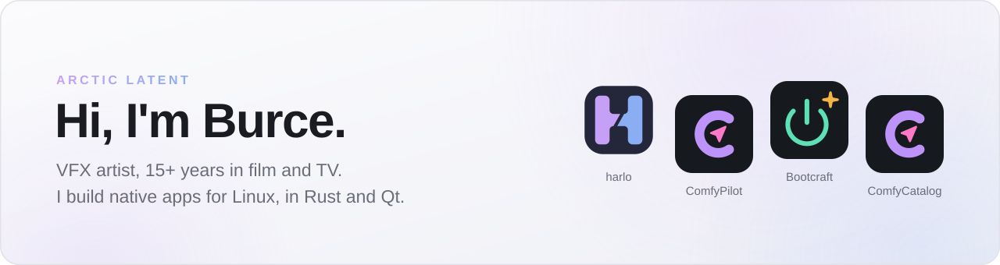
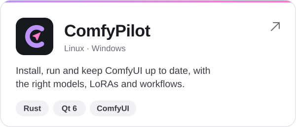
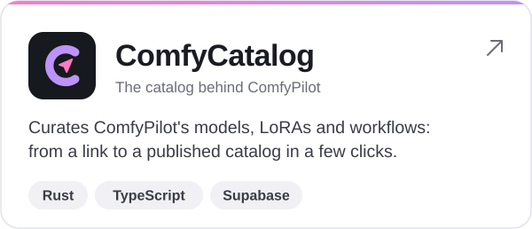

<picture>
  <source media="(prefers-color-scheme: dark)" srcset="assets/banner-dark.svg">
  
</picture>

  <a href="https://harlo.run"><b>harlo.run</b></a> &nbsp;·&nbsp;
  <a href="https://www.youtube.com/@ArcticLatent">YouTube</a> &nbsp;·&nbsp;
  <a href="https://www.linkedin.com/in/burceboran/">LinkedIn</a> &nbsp;·&nbsp;
  <a href="https://burceboran.ca">burceboran.ca</a>

I've spent more than 15 years in visual effects for film and TV. Alongside that I build the tools I want to use myself: native desktop apps for Linux, written in Rust and Qt, for running AI image generation, working with coding agents and setting up a new machine. They're all free and open source, and I make them on my own, so issues, ideas and pull requests make a real difference.

## Apps

  <a href="https://github.com/ArcticLatent/harlo"><picture><source media="(prefers-color-scheme: dark)" srcset="assets/cards/harlo-dark.svg"></picture></a>
  <a href="https://github.com/ArcticLatent/ComfyPilot"><picture><source media="(prefers-color-scheme: dark)" srcset="assets/cards/comfypilot-dark.svg"></picture></a>

  <a href="https://github.com/ArcticLatent/Bootcraft"><picture><source media="(prefers-color-scheme: dark)" srcset="assets/cards/bootcraft-dark.svg"></picture></a>
  <a href="https://github.com/ArcticLatent/ComfyCatalog"><picture><source media="(prefers-color-scheme: dark)" srcset="assets/cards/comfycatalog-dark.svg"></picture></a>

## Also here

- [**Arctic-Helper**](https://github.com/ArcticLatent/Arctic-Helper): the ComfyUI helper ComfyPilot grew out of.
- [**ArcticNodes**](https://github.com/ArcticLatent/ArcticNodes): small ComfyUI nodes, kept lean for my tutorials.
- [**post-linux**](https://github.com/ArcticLatent/post-linux): a post-install script for Linux, with NVIDIA, Flatpak and media setup.

<picture>
  <source media="(prefers-color-scheme: dark)" srcset="https://raw.githubusercontent.com/ArcticLatent/ArcticLatent/output/snake-dark.svg">
  
</picture>
